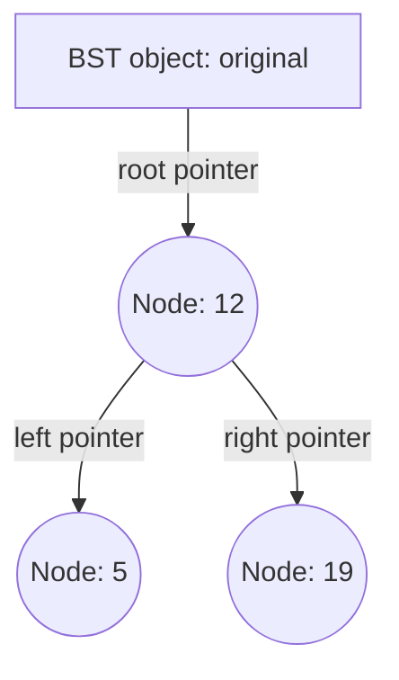

# 12 - BST Copy Constructors

Start here after Chapter 10. **Nine small steps**, focused on translating your existing copy skills into nodes and trees. No repeated int-array copying or assignment-operator exercises.

## Target

[Gonçalo Soares: 16 BST copy constructor](https://goncalo-soares.com/ace-cp/16-bst-copy-constructor/), inspected 17 October 2026. The page asks for a deep copy of a working BST with integer keys, string values, a private nested Node class, and exactly the same tree shape. Insertion, lookup and destruction are already provided. Assignment is excluded. These are original stepping-stone exercises, not a copied solution to that page.

## Order

| Exercise | New idea |
|---|---|
| [01 - Tiny - Find the Nodes](01%20-%20Tiny%20-%20Find%20the%20Nodes/README.md) | Translate object.field and pointer->field |
| [02 - Very Easy - Copy One Root](02%20-%20Very%20Easy%20-%20Copy%20One%20Root/README.md) | A BST owns a Node instead of an int |
| [03 - Easy - Copy a Left Child](03%20-%20Easy%20-%20Copy%20a%20Left%20Child/README.md) | Connect a fresh child to a fresh parent |
| [04 - Easy - Copy Both Children](04%20-%20Easy%20-%20Copy%20Both%20Children/README.md) | Handle left and right independently |
| [05 - Easy - Return a Copied Node](05%20-%20Easy%20-%20Return%20a%20Copied%20Node/README.md) | Translate a private nested return type and wire the helper |
| [06 - Easy - Follow Both Subtrees](06%20-%20Easy%20-%20Follow%20Both%20Subtrees/README.md) | Practise the recursive structure without allocating |
| [07 - Medium - Copy a Left Chain](07%20-%20Medium%20-%20Copy%20a%20Left%20Chain/README.md) | Replace repeated child access with a recursive copy |
| [08 - Medium - Copy a Branching Tree](08%20-%20Medium%20-%20Copy%20a%20Branching%20Tree/README.md) | Combine two recursive results under a new parent |
| [09 - Hard - Independent BST Copy](09%20-%20Hard%20-%20Independent%20BST%20Copy/README.md) | Website-level task with no algorithm supplied |

Exercises 01-05 are short, concrete translations. Exercise 06 adds a recursive helper without allocating. Exercise 07 copies down one side. Exercise 08 connects both sides with most scaffolding supplied. Exercise 09 removes that guidance and reaches the website task's structural requirements. Its extra practice constraint is to clone links directly rather than rebuild via insert.

## The object / node distinction

`BST` and its nested `Node` are different class types. Each BST object contains one pointer member, `root`. Nodes are separately allocated objects. Each Node contains its key, value, and two child pointers. There is no automatically-created Node inside every BST merely because the Node class is declared there.



The boxes and circles above are **objects**, not class definitions. A new copy needs its own root node and its own descendant nodes. A helper returning `Node*` returns the address to connect into the new parent.

## Files and running

Each exercise has `README.md`, `exercise.hpp`, `solution.cpp` and `main.cpp`. Open `solution.cpp` and fill only its TODOs. The chapter's `test_support.hpp` is supplied test infrastructure; no need to study or edit it. Keep the chapter folder together because tests include that shared header. Your existing VS Code play-button build compiles main.cpp and solution.cpp together.

From an exercise folder in PowerShell:

```powershell
g++ -std=c++17 -Wall -Wextra main.cpp solution.cpp -o exercise.exe
.\exercise.exe
```

On Linux/macOS, use `-o exercise` and `./exercise`. For a completed pointer exercise, a sanitizer-capable compiler can use `-g -fsanitize=address,undefined` as well.

The Node destructor already deletes left and right recursively. The BST destructor only deletes root. Do not add a second traversal deleting those same nodes. Tests include independent storage, shape, strings, empty and one-sided trees, and lifetimes. Untouched starters intentionally fail with Not implemented; no finished solutions are included. Allocation failures are out of scope. The public interfaces are deliberately close to the website, with test-only friendship added for checking addresses.
